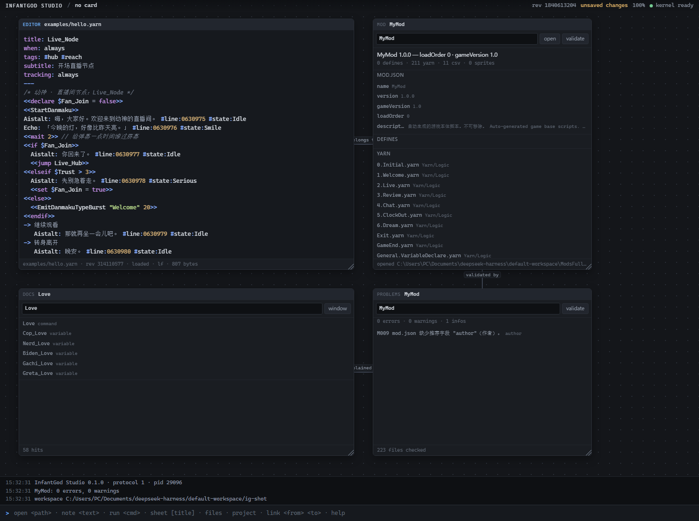

# OsanaKami IDE Studio

OsanaKami IDE Studio is a **mod IDE for 《幼神》 (Infant God)** — a board-shaped
editor for the game's Yarn scripts, ScriptableObject definitions, sprites and
localisation tables.

It is a fork. The upstream project is a small, finished, honest IDE *prototype*
whose stated purpose is to be reshaped into a real product for a real audience;
this repository is one such reshaping. `docs/FORK.md` records exactly what was
renamed, what was kept byte-identical, and what was added.

What it is *not*: a complete product. There is no debugger, no Git integration,
and no undo of the typing inside a card (Ctrl+Z takes back board edits; a
textarea keeps its own undo). The settings card is deliberately small — the AI
provider, the view a window opens in and the poll interval; the workspace, the
mods folder and the port are still command-line arguments, and a window reads
them on boot. Every deliberate tradeoff is written down instead of discovered.



---

## What this fork adds

Three card kinds and one knowledge layer, none of which touches the kernel:

- **`mod`** — opens a mod package: `mod.json`, its defines grouped by type, its
  Yarn files, its sprites. Click a row to edit that file.
- **`problems`** — validation output for a package, worst first, each row
  jumping to the file and JSON pointer it came from.
- **`docs`** — the game's own knowledge base: 136 commands, 63 functions, 678
  variables, 1221 nodes, 51 definition schemas, 1305 baseline defines. A fresh
  install derives a smaller, facts-only base from the installed game on first run
  (see `docs/MODS.md`); this repository's `shell/mods/knowledge.json` is the rich
  baseline a development tree keeps.
- **`.yarn` colouring** — a language descriptor in `langs/`, alongside JSON.
- **`shell/mods/`** — the game intelligence: schema validation, Yarn diagnosis,
  package scaffolding, creating one file from a schema (`mod.newFile`), importing
  an existing file into a package (`mod.importFile`), search and completion. Pure
  Node, zero npm.
- **`settings` card** — one place for the machine rather than the project: the AI
  provider, the view a window opens in and how often the cards poll, stored under
  the user data directory (`config.get`/`config.set`). The workspace and the mods
  folder stay process arguments and are shown, not edited; a change needs a
  restart, and the card says so.
- **`File → New Mod…`** — the desktop shell asks the game layer for a scaffold
  plan and writes a loadable package into a directory you pick (four templates —
  minimal, Yarn story, define pack, full project), says what it is about to
  create first, refuses to overwrite anything, and opens the result as cards.
  The same layer, reached through the protocol: see
  [electron/README.md](electron/README.md) and `docs/MODS.md`.

See [docs/MODS.md](docs/MODS.md) for the verb table, the three card kinds and
the containment rules.

## What OsanaKami IDE Studio is

- A **card document**: one persistent set of cards, drawn by two tiled views. No
  tabs, no file tree. What is open, and what is linked to what, is part of the
  project state.
- **Three layers**, each in a different language, each trimmable:
  - `core/` — the kernel. **C89 only**, zero third-party dependencies.
  - `shell/` — the front end, the HTTP/stdio endpoints, and the game layer.
    **JavaScript ESM**, zero npm dependencies.
  - `tools/` — build driver, protocol driver, a language-descriptor generator.
    **Python 3.12 standard library only**.
- A **window** made of the system's Edge/Chromium launched in
  `--app=http://127.0.0.1:PORT` app mode.
- **Languages** that are actually supported: Yarn Spinner and JSON colouring,
  driven by descriptor files in `langs/`.
- A **frozen JSON-RPC protocol** on stdio, newline-delimited, with a documented
  method list and error-code table.
- **Edits that do not clobber.** An editor card remembers the revision it read
  and sends it back on every write, so a race is refused rather than won. A file
  rewritten by another program — `git checkout`, a formatter, another editor —
  announces nothing, so the shell polls for it and a card either reloads (if you
  have no unsaved edits) or keeps your text and tells you the file moved.

## What OsanaKami IDE Studio is not

- **Not a complete product.** There is no terminal emulator, no debugger, no Git
  integration, no refactoring, and no undo of text inside a card. The settings
  card is not a general preference editor: it writes the three things a window
  and the AI client actually read, and shows the rest without offering to
  change it.
- **Not extensible.** There is no plugin system, by design. Extension means
  forking this repository and editing the source.
- **Not a native window.** The app mode of a browser is not a real application
  window; see the WRY/Tauri note below.
- **Not a Yarn compiler.** The `story` card parses a `.yarn` file into nodes and
  lines, writes it back line for line, completes `<<commands>>` from the mod's own
  compiled schema, and sets the translation tables beside it,
  but nothing here runs, type-checks or compiles a story.
- **Not a paint program.** The `pixel` card decodes and encodes the PNGs this
  game's art actually is — 8-bit RGBA and 8-bit RGB, not interlaced — and draws
  one of them with a pencil, an eraser, a flood fill and an eyedropper over a
  1×–32× canvas; the pixels are the file, saved through
  `file.read_bytes`/`file.write_bytes`, and the board document only remembers
  which file, how big and which colours. There are no layers, no selection, no
  text, no resize and no rotation, and a PNG in any other shape is refused by
  name rather than half-decoded into an image that looks right until the game
  opens it.
- **Not portable yet.** The kernel's platform layer is Win32.

---

## The eight constraints

These are hard constraints, not aspirations. They are what make the code base
forkable, and they are what a fork will change first.

### 1. The paradigm is the document, not tabs and a tree

The main surface is not a tab strip over a file tree. Everything you work on is a
**card** in one persistent document. A card has a `kind` (`editor`,
`runner`, `note`, `files`, `project`, `sheet`, `mod`, `problems`, `docs`), a
position and size (`x`, `y`, `w`, `h`, `z`), may
reference a file, and may be connected by links. The document persists to
`<root>/.infantgod/board.json`, so **what is open and how it relates is part of the project
state**. A non-modal command line at the bottom acts on the focused card.
See `docs/PARADIGM.md`.

The board file is the only document, and the shell draws it two ways — `mode
classic` puts the focused editor into a code area, the open files into a tab
strip above it and a `project`/`files` card, when the document has one, into a
sidebar; `mode mod` arranges that same tile around a mod package — and a window
opens on the mod one, because that is where a mod author works (`mode classic`
moves it to the other tile). Both are *projections*: switching to either creates
no card, moves none, and nothing about them is written to `board.json`. A fork
that deletes a view loses a way of looking, not a piece of project state; the
document is still where the project is. The geometry (`x`/`y`/`w`/`h`,
`viewport`) stays in the file for any view that wants to draw a plane, but no
shipped view reads it, and `mode board` is no longer a mode.


### 2. No Electron in the core

Nothing below the window knows what a window is: the protocol, the language
layer, the mod layer and the board document are all indifferent to how they are
hosted. That is a decision of the *shell*, not of the kernel: the kernel stores
the document, whatever it holds, and knows nothing about cards or views
(`docs/VIEWS.md`). A fork that wants a different main surface replaces this
document and not the core.

The default host stays the system's Edge/Chromium launched in
`--app=http://127.0.0.1:PORT` app mode with a throwaway profile — no bundled
Chromium, nothing to download, and `node shell/main.mjs serve` works on a machine
that has never run `npm install`.

This fork adds an *optional* desktop shell on top: `electron/`, reached with
`npm start`. Handing an installer to mod authors needs a real window, a real
taskbar entry and no dependency on which browser happens to be installed. It is
one file with no preload script and no IPC, and it changes nothing under
`shell/`, `langs/` or `core/`; see `electron/README.md`. `node_modules/` stays a
build-time dependency of the shell, never a runtime dependency of the product.

**For a smaller binary the replacement path is WRY/Tauri**, described in
`docs/FORK.md`; it would also be what makes the kernel portable, which is the
larger piece of work. Electron is what this fork actually ships.

### 3. No plugin system, by design

Extension = fork and edit source. There is no plugin loading, no manifest, no
discovery and no sandbox.

What there *is* is one hook for new card kinds, because "a card is a file with a
cursor" is the assumption most likely to make a fork expensive. The kernel
stores whatever document the shell hands it, verbatim, and the shell's board
model is the only thing that knows what a card is; the shell
registers a kind with a single call:

```js
registerCardKind({ kind: "waveform", render: (card, ctx) => { /* … */ } });
```

The shell registers thirteen kinds — `editor`, `runner`, `note`, `files`,
`project` and `sheet` in the core of `cards.mjs`, then `story`, `pixel`, `rig`,
`mod`, `problems`, `docs` and `settings` — `sheet` being a structured-data grid
(typed cells, rows, columns, TSV export) that exists to prove nothing downstream
assumes text, `project` being the workspace as one project: what the project
contains, merged with what the document has open, `rig` being a skeleton and its
atlas read from the game's own bytes, and `settings` being the one card that
talks about the machine instead of the project. See
[`docs/SURFACES.md`](docs/SURFACES.md) and [`docs/PROJECT.md`](docs/PROJECT.md).

### 4. The build is fully offline

No package manager, no network, no third-party dependencies, no configure step.
The Makefile needs a C89 compiler and GNU make, and either finds them or does
not. `core/` includes only C89 standard headers and `<windows.h>` behind the
platform layer.

### 5. Low coupling, trivially trimmable

Each module under `core/src/` is a whole subsystem with a stated cost of
removal. `infantgod modules` prints the trim manifest. See `docs/TRIM.md`.

### 6. `core/` is C89 ONLY

Enforced by the compiler, not by convention:

```make
CFLAGS = -std=c89 -pedantic -Wall -Wextra -Werror -O2 -Icore/include
```

C++ comments, mid-block declarations, `long long` and variadic macros are all
rejected by `-std=c89 -pedantic -Werror`.

### 7. The project is polyglot on purpose

| layer | language | dependencies |
| --- | --- | --- |
| `core/` | C89 | none beyond libc and the OS |
| `langs/`, `shell/` | JavaScript ESM | zero npm dependencies |
| `electron/` | JavaScript (CommonJS) | Electron + electron-builder, dev only |
| `tools/` | Python 3.12 | standard library only |

### 8. Language intelligence is keyword colouring, and it lives in `langs/`

The kernel knows about files, documents and processes — not about programming
languages. Language support lives in `langs/`, is served by the shell, and is
**deletable**: `rm -rf langs/` leaves a kernel that still builds and a shell that
still runs, rendering plain text. Yarn Spinner is the one language that must be
supported — it is the format 《幼神》 itself is written in, and the descriptor in
`langs/yarn.lang` is the worked example the grammar is exercised against. See
`docs/ARCHITECTURE.md` and `docs/PROTOCOL.md`.

---

## Quick start

Everything below is exactly what was run to verify this document. The versions
it was verified against:

```text
Python 3.12.9
Node   v24.16.0
GNU Make 4.4.1        (<toolchain>\mingw64\bin\mingw32-make.exe)
gcc.exe 14.2.0        (MinGW-W64 x86_64-msvcrt-posix-seh, built by Brecht Sanders, r3)
```

Build the kernel (produces `build/infantgod.exe`):

```sh
mingw32-make -f Makefile
```

`tools/build.py` is a thin driver over the same Makefile, and it is what proves
the toolchain is present:

```sh
python tools/build.py --check     # print resolved make + gcc and exit
python tools/build.py             # build (pass --release / --clean / targets)
```

It finds the toolchain on `PATH` first; if MinGW-w64 lives somewhere else, set
`MINGW_BIN` to that `bin` directory and it looks there instead. No directory
outside the repository is hard-coded — `python tools/path_guard.py` checks that.

Run the checks:

```sh
mingw32-make -f Makefile check       # kernel alone: 13 passed, 0 failed, 3 skipped
mingw32-make -f Makefile fullcheck   # whole endpoint: 16 passed, 0 failed, 0 skipped
mingw32-make -f Makefile probe       # every bug in docs/BUGS.md: all ok
mingw32-make -f Makefile smoke       # the window, headless: 5 + 26 checks, 0 failed
mingw32-make -f Makefile version-check  # every copy agrees, and the changelog has a home for it
mingw32-make -f Makefile test        # check, fullcheck, probe, version-check, the JSON test, all three JS self-tests
```

On a machine with no Chromium-family browser, `make smoke` prints a skip, not a
failure: "no browser" is not a defect in the board, and exit `0` means either
outcome.

The individual pieces, if you want to run them directly:

```sh
python tools/e2e.py --kernel build/infantgod.exe     # 19 passed, 0 failed, 3 skipped
python tools/e2e.py --kernel build/infantgod.exe --keep-going
python tools/kernel_probe.py                         # the fixed bugs: summary: all ok
python tools/seide_cli.py selfcheck                  # the second client, against a scratch workspace: summary: all ok
python tools/browser_smoke.py                        # renders the real window; 61 checks; SKIP (exit 0) with no browser
python tools/input_smoke.py                          # real clicks, keys, wheels, editor keys, the line numbers and the mod view a window opens in: 43 checks
python tools/version.py check                        # every copy of the version, and the changelog section
python tools/demo.py                                 # install the starter board: five cards, three links
build/obj/test_json.exe                        # the C JSON codec: "all good"
node langs/selftest.mjs                        # 91/91 checks passed
node shell/web/selftest.mjs                    # ok 249/249 (pure JS: no DOM)
node shell/mods/selftest.mjs                   # 407/407 checks passed
```

The mod suite reads the game's extracted `Mods` folder for its corpus checks and
skips them (rather than failing) when it is not there; point it at your own copy
with `node shell/mods/selftest.mjs --mods <dir>`.

`make test` runs `check`, then `fullcheck`, then `probe`, then `cli-check`, then
`version-check`, then the JSON test and the three JavaScript self-tests **in that
order**, so a `fullcheck` failure would stop the run before the self-tests are
reached. `check`
drives the bare kernel (`tools/e2e.py --kernel build/infantgod.exe`) and
`fullcheck` the same suite through the shell
(`--kernel-cmd "node shell/main.mjs rpc --workspace ."`), which is what keeps the
protocol honest from both ends. `cli-check` is the protocol's **second
consumer**: `tools/seide_cli.py` runs its own eight checks against a scratch
workspace with no shell code involved, and that is what keeps the frozen contract
honest (see [`docs/PROTOCOL.md`](docs/PROTOCOL.md#a-second-client)).
 `smoke` is separate because it needs a browser: it renders the board
(`browser_smoke.py`, 61 checks) and then drives it by hand -- Ctrl+Z and
Ctrl+Shift+Z, a wheel over a card's own contents, and the editor card's own keys:
Tab and Shift+Tab, Enter after an opener, Ctrl+F, the find bar's next-match
button, replace-all, Escape, and that the textarea's own undo still holds those
edits. Last it opens a file from outside the app — the test writes it with a
plain file write, then again with different bytes — and checks the card notices
on its own and reloads, that a card with unsaved edits is warned instead of
overwritten, and that deleting the file under a card is reported with the text
still in the card, that the editor's gutter holds one number per line and that a
click on it hides it and another brings it back, that a window opens on the
mod tile and that `mode classic` draws the
tile it promises (`input_smoke.py`, 43
checks). On a clone that
has no
document yet both install `examples/board.json` for the run and remove it again
afterwards. As of this writing nothing fails.

**A file changed behind the app's back is noticed, on a timer.** The kernel emits
`file.changed` for the writes it made itself and for nothing else, so a file
touched by another program produces no notification at all. The shell therefore
polls `file.stat` — one call per open editor card every 1.5 s, carrying no file
text — and compares the revision it gets with the one the card read. A card with
nothing unsaved reloads and says `reloaded from disk`; a card with unsaved edits
keeps its text and says `changed on disk (rev N) — ^S overwrites`; a file that
has gone says `gone from disk — ^S writes it back`. The decision table is pure
and lives in `shell/web/watch.mjs`, so `node shell/web/selftest.mjs` covers it
with no DOM. A fork that trims `file.stat` out of its kernel does not break the
app: the watcher turns itself off with one log line
([`docs/PROTOCOL.md`](docs/PROTOCOL.md#file-stat)).

**A window opens on the mod tile.** That is where a mod author works: the
package on the left, the editor in the middle and the validation report
underneath (`BOOT_VIEW` in `shell/web/main.mjs`; `views.mjs`'s `DEFAULT_VIEW`
stays `classic` as the fallback for a word that names no view). The `Mod` button
in the HUD's view switch marks it as the one that is on, and `mode classic` is
how you reach the other tile; `mode mod` comes back. The classic tile arranges
the focused
editor as a code area,
the rest of the open cards as tabs above it and a `project`/`files` card, if the document has
one, as a sidebar. The
arithmetic is pure, lives in `shell/web/classic.mjs` and is measured in the
view's own pixels, which is why `node shell/web/selftest.mjs` can pin the tile
with no DOM and `input_smoke.py` can measure it in a real window. The document
underneath is untouched: the view computes boxes for the *same* cards from the
*same* document, a card with no place in the tile is hidden rather than
unmounted (its text, its scroll position and its listeners survive a round trip),
and neither view pans or zooms, so there is no scale for the HUD to quote.
Nothing about the view is saved, the
document in memory is never rewritten, and no protocol method changed;
[`docs/PARADIGM.md`](docs/PARADIGM.md) states what it is not.

**Every open card has a tab, in both views, and closing one asks first.** The
strip used to be the classic tile's and to hold only editors; it now belongs to
the tile and holds every kind of card, so a note, a story or a pixel card opened
in one view is reachable in the other instead of being open and invisible (the
sidebars keep what they always showed: `project`/`files`, and in the mod tile
`mod` and the problems report). A card's tab closes with its `x`, a middle click
or `Ctrl+W` — one path, one neighbour rule (the tab to the right, else the left,
else nothing) — and a card holding unsaved text is asked about first: `save and
close`, `discard`, or `cancel`, with Escape meaning cancel and a save that fails
keeping the card and its text. A clean card closes without a question. The
question is an inline strip above the command line, not a dialog.

**The views are views, and there are two of them.** A view's arrangement is only
meaningful because it is computed — nothing is dragged into place — so the HUD
switch carries `classic` and `mod`, and the plane a card's `x`/`y` once described
is no longer a mode at all: `mode board` is answered as an unknown view. The
same reasoning folds the message strip away: it is the whole of the app's dialog
system — there are no modals, nothing ever covers what you are reading — but a
strip of running commentary under the code is the tool of the person writing the
code, so it starts closed and the HUD's button (or the command line) opens it. A
line that arrives while it is shut turns that button into a count
coloured by the worst line waiting, and an `error` opens the strip by itself.

**The protocol suite used to write to your board, and no longer does.** The
board checks drive `view.save` against the workspace they were given, but they
snapshot the whole document that was already there and restore it before the
check returns — including when the check fails. A run against `.` leaves
`./.infantgod/board.json` semantically identical; with the shipped starter board
it comes back byte-identical too, byte-for-byte, because the kernel writes the
same canonical form back. If there was no board before a run, there is none after
it either — and no empty `.infantgod/` directory left behind where the board used
to be.

**The board shipped for a fresh clone is verified, not assumed.** The `starter
board` check saves `examples/board.json` and requires cards, links and viewport
to come back exactly, so a hand-edit the shell cannot read fails here rather than
on a new user's first launch. The kernel does not judge the shape of that file
(`docs/VIEWS.md`); the shell's board model is what reads it, and
`node shell/web/selftest.mjs` is where the shape is tested.

**Current state of the protocol suite:** both modes are green. Kernel mode
(`check`) reports 13 passed, 0 failed, 3 skipped — the skips are the three
language checks, which the kernel does not serve. Full mode (`fullcheck`, the
endpoint that adds `langs/`) reports 16 passed, 0 failed, 0 skipped. See
[Known rough edges](#known-rough-edges) for what is still genuinely unfinished.

Note `make test` uses `fullcheck`, which needs `node shell/main.mjs`; there is no
make target that runs only the JavaScript self-tests.

Start the app (builds the window from the system browser):

```sh
python tools/demo.py                                 # install the starter board first
node shell/main.mjs serve --workspace .
node shell/main.mjs serve --workspace . --no-open    # just serve, print the URL
node shell/main.mjs rpc --workspace .                # stdio endpoint, no browser
```

`.infantgod/` is gitignored, so a fresh clone opens an **empty document** — the
layout is per-checkout project state, deliberately not committed. `tools/demo.py`
copies `examples/board.json`, the five-card document in every screenshot here, into
`.infantgod/board.json`. It refuses to overwrite a document you already have unless
you pass `--force`, and `--print` shows it without touching anything. Opening an
empty document is fine too: the command line is what tells you the commands, and
`project` gives you the workspace.

Point it at the game's mods so the 幼神 cards have something to open:

```sh
node shell/main.mjs serve --workspace . \
  --mods-root "…/Infant God/StreamingAssets/Mods"
```

Then, on the command line: `mod MyMod`, `problems MyMod`, `docs Love`.
`--mods-root` narrows what `mod.*` may touch; it defaults to `--workspace` and
can never widen it.

The kernel is usable with no UI at all:

```sh
build/infantgod.exe help
build/infantgod.exe version
build/infantgod.exe modules
build/infantgod.exe view show --path .infantgod/board.json --root .
build/infantgod.exe rpc --root . --verbose
```

---

## Repository map

```
Makefile                the whole build: CC, CFLAGS, SRC, all, check, fullcheck,
                        probe, smoke, test, modules, run, clean, and the JSON
                        test target
README.md               this file
LICENSE                 MIT -- the code.  Except the docs: see below
LICENSE-DOCS            CC BY-NC-SA 4.0 -- every Markdown file in the repository
EULA.txt                the early-version notice the installer shows
CHANGELOG.md            what is in this version, and what is not
.github/workflows/      CI: the same make targets, on a Windows runner
.gitignore              build artefacts and workspace-local state
.gitattributes          the checkout is the repository's bytes: LF everywhere

core/                   the kernel -- C89, no dependencies
  include/              public headers: buf, vec, json, port, wksp, view, exec,
                        serve, rpc, app, module, infantgod_cfg
  src/                  one file per module: buf, vec, json, wksp, view, exec,
                        rpc, serve, app, main
  port/                 the only OS-aware code: sys_win32.c, proc_win32.c
  tests/                test_json.c (JSON round-trip harness for the kernel)

langs/                  language support, deliberately OUTSIDE the kernel
  yarn.lang             Yarn Spinner: headers, builtins, <<commands>>, #tags
  json.lang             JSON, including the ScriptableObject definition files
  lang.mjs              descriptor parsing, validation, registry
  tokenize.mjs          the tokenizer and its tiling guarantee
  selftest.mjs          node langs/selftest.mjs -- no kernel needed
  README.md             the descriptor grammar and wire shapes

shell/                  the front end and the endpoints
  main.mjs              `infantgod rpc` (stdio) and `infantgod serve` (HTTP + SSE +
                        browser); also the `mod.*` verb table
  mods/                 the 幼神 layer -- game knowledge, no DOM
    index.js            the facade: openMod, validatePackage, diagnoseYarn,
                        scaffold, search, docFor, suggest, localization
    knowledge.json      the development tree's rich baseline: 136 commands,
                        63 functions, 678 variables, 1221 nodes, 51 schemas,
                        1305 baseline defines, 11 locales.  Not shipped: an
                        install derives its own facts-only base
    knowledge-build.js  that derivation, as a pure function: buildKnowledge(
                        gameModsDir); tools/gen_knowledge.mjs is its CLI
    yarn.js             Yarn lexing, tag extraction, arity and jump checks
    validate.js         JSON-Schema + baseline validation of a mod package
    scaffold.js         template-driven package generation (writes real PNGs)
    search.js           the index behind search/docFor/suggest (no `require`)
    selftest.mjs        node shell/mods/selftest.mjs -- 407 checks, no kernel
  web/                  the front end: index.html, style.css, board.mjs, cards.mjs,
                        views.mjs, history.mjs, rpc.mjs, watch.mjs, classic.mjs,
                        modview.mjs, main.mjs, story.mjs, storycsv.mjs, ysls.mjs,
                        pixelpng.mjs, selftest.mjs, README.md

tools/                  Python 3.12, standard library only
  build.py              drives the Makefile; --check / --release / --clean
  e2e.py                drives the protocol end to end over stdio
  kernel_probe.py       re-checks every bug in docs/BUGS.md, on a scratch workspace
  kernel_drive.py       the stdio JSON-RPC harness kernel_probe.py runs on
  browser_smoke.py      renders the board in a real browser and asserts the DOM
  input_smoke.py        drives the real input paths: undo keys, wheel ownership,
                        and a file rewritten behind the app's back
  seide_cli.py          the protocol's second client -- hello, info, ls, cat,
                        write, board, run, selfcheck
  version.py            the one place a version number is decided (show/check/set)
  demo.py               installs examples/board.json as this workspace's board
  newlang.py            writes a conforming .lang descriptor
  make_icon.py          draws electron/icon.ico from the palette, not by hand
  sign.mjs              electron-builder with the local signing identity attached
  README.md             what each tool is for

examples/               hello.yarn, sample.json (the shipped fixtures), and
                        board.json -- the starter board `tools/demo.py` installs
docs/                   PARADIGM.md, VIEWS.md, ARCHITECTURE.md, PROTOCOL.md,
                        SURFACES.md, MODS.md, PROJECT.md, TRIM.md, FORK.md,
                        BUGS.md
```

Build artefacts (`build/`, and the workspace-local `.infantgod/`) are ignored by
Git. `examples/` is **not** ignored: the `.yarn` and `.json` fixtures are part of
the project. `.gitattributes` pins `* text=auto eol=lf`, so the bytes in the
repository are the bytes a clone gets — the fixtures are compared byte for byte,
and a CRLF checkout would fail the suite on a file nobody edited.

---

## Known rough edges

Stated plainly, because a fork needs to know what it is inheriting.

- **`file.read` means different things at the two endpoints.** The shell adds a
  `lang` member (the detected language id, or `null`); the kernel does not,
  because it has no language layer. `docs/PROTOCOL.md` marks which members come
  from which layer.
- **A single read is still capped at 4 MiB; a file no longer is.** `file.read` and
  `file.read_bytes` carry a whole file through one JSON value and still refuse
  anything over 4 MiB with `1003 file is too large to open` — the game's
  localisation CSVs are 4.5-5.75 MB, which is exactly where that stopped.  The
  `file.blob*` session verbs are the companion for the files that are bigger than
  a JSON string should be: a session reads a table in 1 MiB frames and writes one
  the same way, so the story card opens a real `NewProject_<lang>.csv` instead of
  reporting a read failure.  The `problems` panel and the mods layer still read
  and validate a package in Node rather than through the kernel, which is why
  `problems` works on a package the editor has never opened.
- **The kernel has no delete or rename.** Copying a mod package into
  `StreamingAssets/Mods/<Name>/` is therefore a manual step; `mod.scaffold`
  creates directories through `file.write`'s parent-directory creation.
- **The kernel refuses any file containing a NUL byte**, so `.png` and `.bytes`
  assets can be listed and diagnosed but not read or written through the document.
- **Language colouring offsets are JS string indices, not bytes.** For Yarn this
  is what makes Chinese prose highlight correctly; the upstream README's
  "byte offsets" claim was wrong, and `langs/selftest.mjs` pins the gap over a
  shipped CJK fixture by measuring both, so a regression cannot pass unnoticed.
  The Python side is not a residue: `tools/e2e.py` measures its own fixtures in
  the same space (`js_length`) and judges every span in that same space, so its
  tiling check stays honest even for an astral character.  What would drift is
  any *new* check that compared a wire span to Python's `len(text)`, which
  counts code points.
- **Links are data, not drawings.** No router, no obstacle avoidance, no
  automatic layout, and no shipped view draws a link: the relationship is in the
  document. Undo has the same limit: it takes back board edits, and does not
  reverse anything a view computes.
- **The shell is the only *window*.** `tools/seide_cli.py` is a second protocol
  client and `make cli-check` drives it, but it is a command line: every
  rendering of a view still goes through `shell/web/`, so the drawn client has
  exactly one consumer to keep honest.
- **A file changed outside the app is noticed late, by up to ~1.5 s.** The shell
  polls `file.stat` for the paths its cards hold; the kernel does not watch the
  filesystem and the protocol does not promise an event. A card that held a file
  somebody else rewrote is corrected on the next tick, not at the instant it
  happens — and `file.stat` reports `revision: 0` for anything over 4 MiB, because
  a revision means hashing the file the kernel will not read whole, so a card on a
  file that big still warns that its file changed rather than reloading it.  The
  blob session is how such a file is *read and written*; it is not how the watcher
  compares it.  (The kernel compares a base revision correctly at the write, so
  nothing is overwritten blind: a save against a five-megabyte table that moved
  under the card is refused with `1001`, not applied.)

---

## Fork it in 10 minutes

Start with `docs/FORK.md` — it is the playbook, ordered by cost. The short
version:

1. Rename the product (`README.md`, `shell/main.mjs`'s `SHELL_VERSION` and
   usage text, `core/include/infantgod_cfg.h`, `core/src/main.c`).
2. Delete what you do not want: `infantgod modules` prints the cost of each module,
   and `docs/TRIM.md` lists the four edits per removal.
3. Change the window: replace `shell/main.mjs`'s browser launcher with WRY/Tauri
   (`docs/FORK.md`).
4. Add your card kind, or your language — `docs/FORK.md` has both recipes.

The protocol is frozen (`docs/PROTOCOL.md`). Keep the JSON-RPC shape and you can
replace every layer under it in any order.

The docs, in reading order: [`docs/PARADIGM.md`](docs/PARADIGM.md) — why the
board and not tabs; [`docs/VIEWS.md`](docs/VIEWS.md) — what the kernel calls a
view, and why it does not know what is in yours;
[`docs/ARCHITECTURE.md`](docs/ARCHITECTURE.md) — what each
layer is; [`docs/PROTOCOL.md`](docs/PROTOCOL.md) — the frozen wire;
[`docs/SURFACES.md`](docs/SURFACES.md) — non-text cards and the card-kind hook;
[`docs/PROJECT.md`](docs/PROJECT.md) — the workspace as one project;
[`docs/TRIM.md`](docs/TRIM.md) — how to cut a module out;
[`docs/FORK.md`](docs/FORK.md) — the fork playbook;
[`docs/BUGS.md`](docs/BUGS.md) — every defect probing found, with its root cause
and fix, so a fork knows what was already tried.

> Rejected alternative: **a Rust kernel**. It was dropped because a dependency's
> build script needed a C compiler, which broke constraint 4 (fully offline,
> no configure step). C89 has no build script and no dependency graph.

---

## Version, licence, CI

The version is one line — `#define SDE_VERSION` in
[`core/include/infantgod_cfg.h`](core/include/infantgod_cfg.h) — mirrored by
`SHELL_VERSION` in `shell/main.mjs`, because C89 and JavaScript cannot read a
file at build time. `build/infantgod.exe version` prints it, and it is the same
number in both; no build step generates it.

The code is [MIT](LICENSE) — take it, fork it, rename it, sell it. The
documentation (the Markdown files, this one included) is
[CC BY-NC-SA 4.0](LICENSE-DOCS): quote it, translate it, rewrite it for your
fork, keep the attribution — but not for commercial use, and an adaptation of it
stays under the same licence. Two licences, two scopes, both spelled out in
[LICENSE-DOCS](LICENSE-DOCS). The non-commercial, share-alike choice covers the
prose because this is a free modding tool: the writing is the part a paid course
or a commercial fork would repackage, and the code is not restricted that way —
MIT grants commercial use, and nothing here takes it back. CC BY-NC-SA 4.0 is
not an open-source licence, and this file does not call it one: the repository
is source-available, the prose is non-commercial and share-alike on purpose.
OsanaKami IDE Studio is a derivative of the MIT-licensed seIDE, and a rename
does not change what a licence allows: the kernel, the shell, the tools and the
fixtures are MIT, and only the prose is CC BY-NC-SA 4.0. OsanaKami IDE Studio is
not affiliated with, endorsed by or authorised by the makers of the game it
edits, and it claims no trademark in that game's names or marks; it names the
game only to say what it is compatible with.

The installer shows [EULA.txt](EULA.txt) on its licence page instead of the MIT
file, because this build is early and not stable, and the one thing worth saying
before an install is what that costs you: it may have bugs, it writes the files
under your Mods directory, back them up. It is not a restrictive agreement — it
says itself that it narrows nothing the licences above grant you, and defers to
them; the only binding term it repeats is the documentation licence, CC BY-NC-SA
4.0. It also says plainly that selling this early, AI-authored build is **not
recommended** — a request, not a restriction, because the code's MIT licence does
not allow one. It also discloses how the program was made, which is part of
judging an early build: it is AI-authored throughout, corrected by hand through
DSH sessions. The program stays free to use, fork, rename and redistribute, and
the code stays free to sell on MIT's terms; the licence page is about the build
you are installing, not about the repository.

The payload the installer carries is the IDE, not the game: `npm run pack` packs
`electron/`, `shell/`, `langs/` and `examples/`, `package.json` keeps
`shell/mods/knowledge.json` out of it, and a release build runs a text audit over
the packed files before compiling — it fails on the game's names, its cast, or a
developer's absolute path, and it fails while the audit's allow-list is non-empty.
`node tools/make-installer.mjs --audit-only` runs just that check;
`build/make-installer.json` records whether the build that ran was a `--dev` build
and whether it was `releaseReady`. The knowledge baseline is not shipped because
the app derives it from the player's own game; `docs/MODS.md` says how.

CI is [`.github/workflows/ci.yml`](.github/workflows/ci.yml): the `test` job runs
the same `make CC=gcc test` a maintainer runs, and the `smoke` job renders the
board headless. Neither job has run on a GitHub runner — the file was authored on
a machine with none — so treat them as unproven until the first green run; the
commands inside them are exactly the ones in **Quick start** above.
